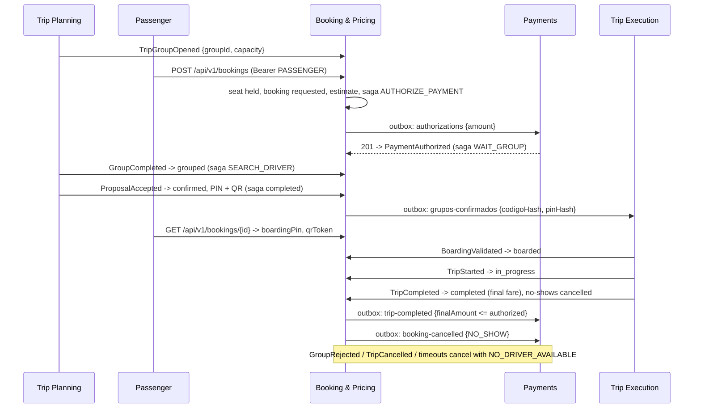
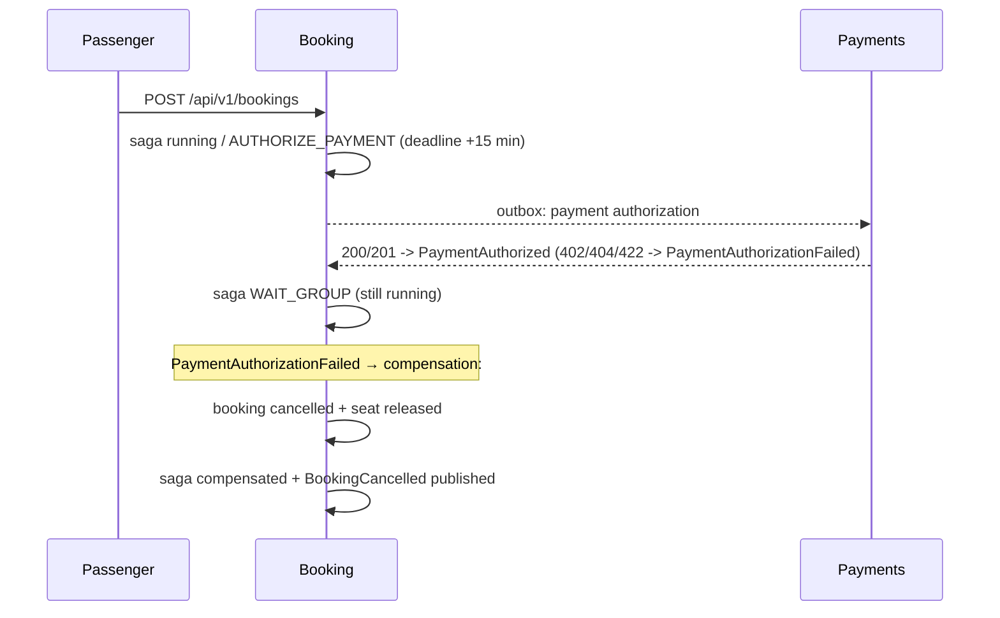
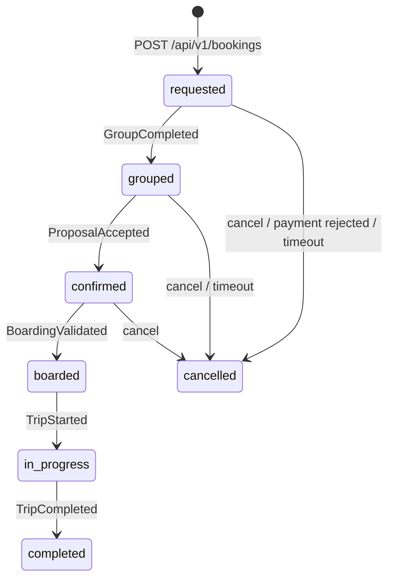

# ShareWay Booking & Pricing

Backend microservice for booking shared trips, reserving seats with optimistic locking, managing pricing rules, and estimating fares. `booking` and `pricing` are independent bounded contexts and communicate only through identifiers.

It is the centre of the ShareWay flow: it receives the events of **Trip Planning** (groups) and **Trip Execution** (boarding and trips) on `POST /api/v1/internal/events`, and calls **Payments** (authorization, cancellation, capture) and **Trip Execution** (confirmed groups) through a transactional outbox. See [Service integration](#service-integration).

## Requirements

- Java 21
- Maven Wrapper
- PostgreSQL on `localhost:5432`
- Development database `shareway_booking`

All environment-specific configuration comes from environment variables: `DB_URL`, `DB_USER`, `DB_PASSWORD` and `SERVER_PORT`, plus the integration variables `JWT_SECRET`, `INTERNAL_API_KEY`, `PAYMENTS_URL`, `TRIP_EXECUTION_URL` and `OUTBOX_RELAY_ENABLED` (see [Environment variables](#environment-variables)). Defaults exist **only** in the `dev` profile (`application-dev.yml`), which is also the only profile that imports the optional local `.env` file: copy `.env.example` to `.env` and set `DB_PASSWORD`. `.env` is ignored by Git and must never be committed. Environment variables supplied by the process take precedence over the file.

The `prod` profile (`application-prod.yml`) has no database defaults at all, so a cloud deployment must set `SPRING_PROFILES_ACTIVE=prod` together with the four database variables, `JWT_SECRET` and `INTERNAL_API_KEY`. For IntelliJ, either configure them under **Run Configuration -> Environment variables** or keep them in the local `.env` file and launch with the `dev` profile. The platform fee is not configurable per environment, it comes from the `fare_rules.platform_fee_pct` column of the active fare rule.

```powershell
./mvnw.cmd spring-boot:run "-Dspring-boot.run.profiles=dev"
```

The application uses Flyway migrations and `spring.jpa.hibernate.ddl-auto=validate`:

- `V1__create_booking_tables`: the booking and pricing schema.
- `V2__seed_test_data`: the first fare rule (version 1: base 5.00, 1.20 per km, 10 % fee) and a demo group `11111111-...`. It is kept unchanged so its Flyway checksum still matches in the databases that already applied it.
- `V3__service_integration`: the integration columns of `bookings`, `processed_events` (idempotency of the internal endpoint), `outbox_messages`, the same fare rule as a baseline (inserted only when `fare_rules` is empty, so after V2 it does nothing) and the removal of the V2 demo group when nothing references it: trip groups are opened by Trip Planning (`TripGroupOpened`) and the tests create their own data.

## Integration-test database

Integration tests use local PostgreSQL only, never the development database. Create the separate test database once:

```powershell
psql -h localhost -p 5432 -U postgres -d postgres `
  -c 'CREATE DATABASE "shareway-booking-pricing-test";'
```

Define `DB_PASSWORD` for the development application. Define `TEST_DB_PASSWORD` as well when the test database uses a different password. Tests accept `TEST_DB_URL` and `TEST_DB_USER`, but the safe default is `jdbc:postgresql://localhost:5432/shareway-booking-pricing-test`. The test profile configures a 30-connection Hikari pool and aborts if the URL does not point to `localhost` and a database ending in `-test`.

Run the full suite from a terminal:

```powershell
$env:DB_PASSWORD = "your-development-password"
$env:TEST_DB_PASSWORD = "your-test-password"
./mvnw.cmd -q verify
```

In IntelliJ, open the test Run Configuration, set the same environment variables (`DB_PASSWORD`, `TEST_DB_PASSWORD`, and optionally `TEST_DB_URL`/`TEST_DB_USER`), and run the tests. Do not point test variables to `shareway_booking`.

## Local database reset

`docs/db/reset-local.sql` is a manual development-only operation. Before running it, verify that the connection is exactly `jdbc:postgresql://localhost:5432/shareway_booking`. It drops and recreates only the `public` schema:

```bash
psql -h localhost -p 5432 -U postgres -d shareway_booking \
  -f docs/db/reset-local.sql
```

The same script can be run from an IntelliJ PostgreSQL console. It is never executed automatically by the application.

## Base de datos en Supabase

The service can run against a PostgreSQL database hosted in Supabase (free plan). Use the **Session pooler**:

| Setting | Value |
| --- | --- |
| Host | `aws-1-sa-east-1.pooler.supabase.com` |
| Port | `5432` (Session pooler) |
| Database | `postgres` |
| User | `postgres.<project-id>` |
| Password | the database password set in the Supabase dashboard |

- **Use the Session pooler, not the other two options**: the Transaction pooler (port `6543`) requires special session handling that the JDBC driver does not do by default, and the direct connection is IPv6-only and does not work from most home networks.
- The JDBC URL must keep `sslmode=require`, e.g. `jdbc:postgresql://aws-1-sa-east-1.pooler.supabase.com:5432/postgres?sslmode=require`.
- The password is passed only through `DB_PASSWORD`, exactly as typed in the dashboard: do not URL-encode it, do not add it to the URL and do not write it in any file that gets committed (`.env.supabase` and `.env` are ignored; only `.env.supabase.example` and `.env.example` are tracked).
- **A free Supabase project pauses after about a week without use.** The first connection after waking it up can take ~30 seconds or fail once; just retry. A nightly job or any weekly request keeps it awake.
- Migrations are applied automatically by Flyway at startup; `spring.jpa.hibernate.ddl-auto=validate` only checks the schema, and `spring.flyway.clean-disabled=true` blocks `clean` in every profile except tests. In the `prod` profile HikariCP keeps the pool small (`DB_POOL_SIZE`, default `5`, `minimum-idle=1`, `connection-timeout=20s`) to stay inside the free pooler limits.
- Copy `.env.supabase.example` to `.env.supabase` for Docker Compose-style usage, or load the variables for a single PowerShell session without touching any file (they disappear when the window closes):

```powershell
$env:DB_URL = "jdbc:postgresql://aws-1-sa-east-1.pooler.supabase.com:5432/postgres?sslmode=require"
$env:DB_USER = "postgres.<project-id>"
$env:DB_PASSWORD = Read-Host "Supabase password"   # typed, never written to disk or history
$env:DB_POOL_SIZE = "5"
$env:SPRING_PROFILES_ACTIVE = "prod"
$env:SERVER_PORT = "8080"
./mvnw.cmd spring-boot:run
```

## API

Every `/api/v1/**` route except the internal one requires `Authorization: Bearer <token>`: an HS256 access token issued by Driver Management and signed with `JWT_SECRET` (validated with jjwt 0.12.6, as Payments, Driver Management and Trip Planning do). The caller is the `sub` claim (a UUID) and the role the `role` claim (`PASSENGER`, `DRIVER`, `ADMIN`). `X-User-Id` is no longer read. A missing, malformed, expired or foreign-signed token answers `401`; a role that may not use the operation answers `403`; both with the uniform error body.

| Route | Who | Notes |
|---|---|---|
| `POST /api/v1/bookings` | `PASSENGER` | Body `groupId`, `requestId` and optional `paymentMethodId`; header `Idempotency-Key`. |
| `GET /api/v1/bookings` | `PASSENGER` (own) / `ADMIN` (all) | Newest first. Other roles: `403`. |
| `GET /api/v1/bookings/{bookingId}` | owner or `ADMIN` | Another passenger's booking answers `404`. |
| `POST /api/v1/bookings/{bookingId}/cancel` | owner | Another passenger's booking answers `404` (no admin bypass). |
| `GET /api/v1/fares/**`, `GET /api/v1/fare-rules/**` | any authenticated user | |
| `POST /api/v1/internal/events` | `X-Internal-Api-Key` only | A JWT is never accepted here. |
| `/actuator/health/**`, `/swagger-ui.html`, `/swagger-ui/**`, `/v3/api-docs/**` | public | `/actuator/info` requires a token. |

- `POST /api/v1/bookings` returns `202 Accepted` with `Location` and the booking. In one local transaction it holds a seat of `seat_inventories` with an optimistic lock, creates the booking in `requested`, records the `estimated` fare (date, distance from `GroupInfoProvider` and the passengers of the group) and keeps it on the booking as `estimatedAmount`, starts the booking saga (`running`, `current_step=AUTHORIZE_PAYMENT`, `deadline_at=now+15min`), publishes `SeatHeld` + `PaymentAuthorizationRequested` and queues the payment authorization in the outbox. Replaying the same `Idempotency-Key` returns the original booking without creating another one. `400` if `groupId` or `requestId` is missing; `404` if the group is unknown or no fare rule is valid today; `409` with `"The trip has no seats available."` when there are no seats or the optimistic lock keeps failing after `booking.reservation.max-attempts` retries.
- The booking body is `{bookingId, groupId, requestId, status, estimatedAmount, currency}` (status in uppercase) plus `boardingPin` and `qrToken` for the **owner** of a booking that is `CONFIRMED` or further (see [Boarding codes](#boarding-codes-decision)).
- `POST /api/v1/bookings/{bookingId}/cancel` cancels a booking and releases its seat. Only bookings in `REQUESTED`, `GROUPED` or `CONFIRMED` can be cancelled; `boarded`, `in_progress` or `completed` answer `409` with a clear message, cancelling twice answers `200` without changes and an unknown booking answers `404`. The owner gets `200 {bookingId, status: CANCELLED, penaltyAmount, currency}` (`penaltyAmount` is `null` when there is no penalty). A cancellation closer than 30 minutes to the departure also creates a `penalties` row (20 % of the estimated fare, minimum 1.00, reason `LATE_CANCELLATION`). When the payment was authorized, Payments is told (`PASSENGER_CANCELLED`).
- `POST /dev/events` (only with the `dev` profile, no token needed) publishes a simulated event through the same bus; see [Simulated events](#simulated-events-dev-profile).
- `GET /api/v1/fare-rules` lists the fare rules; `GET /api/v1/fare-rules/{id}` retrieves one. The contract exposes **only GET** for fare rules: there is no `POST` and no `PUT`.
- `GET /api/v1/fares/estimate?groupId=` returns `200 {amount, currency, ruleVersion}`; `404` when the group has no seat inventory or no fare rule is valid today. Read-only: nothing is persisted.
- Swagger UI: `/swagger-ui.html`; OpenAPI document: `/v3/api-docs` (it documents the `bearerAuth` and `internalApiKey` schemes).
- Health: `GET /actuator/health` with liveness and readiness (`/actuator/health/liveness`, `/actuator/health/readiness`) and `GET /actuator/info`. Only `health` and `info` are exposed; no other actuator endpoint exists.

`JwtSecretValidator` (copied from Driver Management) refuses to start the service outside the `dev`, `test` and `local` profiles when `JWT_SECRET` is missing, shorter than 32 characters or still the development example value.

> **Nota:** Este servicio debe quedar detrás del API Gateway; no exponerlo directamente a internet.

## Gateway integration

Set the API Gateway upstream for Booking & Pricing to the Render service URL, for example:

```text
UPSTREAM_BOOKING_PRICING=https://<shareway-booking-pricing>.onrender.com
```

Replace `<shareway-booking-pricing>.onrender.com` with the actual public Render hostname. The gateway must keep the `/api/v1` prefix and forward the `Authorization` header unchanged: this service validates the JWT again with the shared `JWT_SECRET`. The gateway must **not** expose `/api/v1/internal/**`: it is only for the other services, which call it with `X-Internal-Api-Key`.

Final service routes:

- `POST /api/v1/bookings`
- `GET /api/v1/bookings`
- `GET /api/v1/bookings/{bookingId}`
- `POST /api/v1/bookings/{bookingId}/cancel`
- `GET /api/v1/fares/estimate?groupId={uuid}`
- `GET /api/v1/fare-rules`
- `GET /api/v1/fare-rules/{id}`

Public operational routes remain `/swagger-ui.html`, `/v3/api-docs` and `/actuator/health`. The Docker Healthcheck uses `/actuator/health`.

## Design differences

The implementation diagrams should not represent these as deployed components: there is no RabbitMQ or other message broker and no Redis cache. Events between services travel over HTTP: inbound on `POST /api/v1/internal/events` (idempotent by `eventId`), outbound through the transactional outbox (`outbox_messages`) sent by a scheduled relay. Inside the service the events are dispatched synchronously by the in-memory `EventPublisher`, in the transaction of the change. PostgreSQL is the persistence and optimistic-lock source, and Flyway owns schema creation/migrations.

## Service integration

### Environment variables of the integration

| Variable | Default | Purpose |
|---|---|---|
| `JWT_SECRET` | none (`dev` and tests use the example value) | HS256 key shared with Driver Management. Outside `dev`, `test` and `local` the service does not start when it is missing, shorter than 32 characters or the example value. |
| `INTERNAL_API_KEY` | none (`dev`, `test` and `local` use the shared development value) | `X-Internal-Api-Key` expected on `/api/v1/internal/**` and sent to Payments and Trip Execution. Outside `dev`, `test` and `local` the service does not start when it is missing or is the development value. |
| `PAYMENTS_URL` | `https://shareway-payments-settlement-service.onrender.com` | Base URL of Payments & Settlement. |
| `TRIP_EXECUTION_URL` | `https://shareway-trip-execution.onrender.com` | Base URL of Trip Execution. |
| `OUTBOX_RELAY_ENABLED` | `true` (`false` in the `dev` profile) | Runs the outbox relay every 5 s. In `dev` the messages stay queued so nothing is sent to Render; the tests turn it off and call the relay directly. |

Every HTTP call uses a 90 s connect/read timeout: free Render services can take up to a minute to wake up. An empty `PAYMENTS_URL`/`TRIP_EXECUTION_URL` falls back to the default.

### Inbound: `POST /api/v1/internal/events`

Only callable with `X-Internal-Api-Key` (compared in constant time; `401` when it is missing or wrong). Body: `{"eventId", "occurredAt", "type", ...fields}`.

| Type | Sender | Fields | Effect |
|---|---|---|---|
| `TripGroupOpened` | Trip Planning | `groupId`, `capacity` | Creates the seat inventory (`available_seats = capacity`). |
| `GroupCompleted` | Trip Planning | `groupId` | Only the `requested` bookings whose payment is authorized (saga at `WAIT_GROUP`) → `grouped`; saga → `SEARCH_DRIVER`. |
| `ProposalAccepted` | Trip Planning | `groupId`, `driverId` | `grouped` → `confirmed` with new boarding codes; saga → `completed`; ONE `GroupConfirmed` message queued for Trip Execution. |
| `GroupRejected` | Trip Planning | `groupId`, `driverId` | Active bookings → `cancelled` without penalty (`NO_DRIVER_AVAILABLE`), seats released, sagas compensated. |
| `TripStarted` | Trip Execution | `groupId`, `tripId` | `boarded` → `in_progress`. |
| `BoardingValidated` | Trip Execution | `bookingId`, `tripId` | `confirmed` → `boarded`. |
| `TripCompleted` | Trip Execution | `groupId`, `tripId`, `driverId`, `completedAt`, `distanceKm` (may be `null`), `boardedBookingIds` | Bookings that travelled → `completed` with the `final` fare (distance of the event, or `GroupInfoProvider` when `null`); `confirmed` bookings not in `boardedBookingIds` → `cancelled` (`NO_SHOW`); ONE `trip-completed` message queued for Payments. |
| `TripCancelled` | Trip Execution | `groupId`, `tripId`, `reason` | Same as `GroupRejected`. |

- **Idempotency**: the `eventId` is stored in `processed_events` in the same transaction as every change the event makes (outbox messages included). A repeated `eventId` answers `202 {"status":"DUPLICATE"}` and is not processed again.
- **Answers**: `202 {eventId, type, status: PROCESSED | DUPLICATE}`. A valid event that changes nothing (a group without bookings, a booking in another status, an unknown booking) is also `202` and is logged, never `4xx`, because the senders treat every `4xx` as a definitive failure. An unknown `type` or a missing/malformed field is `400`. If the event cannot be processed right now (for example a lock conflict that persists after the retries) nothing is committed and the answer is `503`, so the sender retries.
- The conversion of the JSON into events (`IntegrationEventParser`) is shared with `POST /dev/events`, which stays for the `dev` profile only.

### Outbound: transactional outbox

Every call to another service is stored in `outbox_messages` **in the transaction of the change that produced it**, so it exists if and only if that change was committed. `OutboxRelay` (scheduled every 5 s while `OUTBOX_RELAY_ENABLED=true`) sends the pending messages in the order they were stored (`sequence_number`), with the `X-Internal-Api-Key` header:

- `2xx`: done.
- Timeout, connection error, `3xx`, `5xx`, `401`, `408` or `429`: retried with exponential backoff (5 s doubling, at most 5 minutes). The batch **stops** there so no later message overtakes it.
- Any other `4xx`: the message is marked failed (`failed_at`, `last_error`) and the batch goes on.

| Message | Request | Special answers |
|---|---|---|
| Payment authorization (on booking creation) | `POST {PAYMENTS_URL}/api/v1/internal/payments/authorizations` `{bookingId, passengerId, paymentMethodId?, amount, currency: "PEN"}`. `paymentMethodId` is omitted when the passenger did not send one, so Payments uses the passenger's most recent active card. | `200`/`201`: `PaymentAuthorized` is published locally (payment recorded, saga → `WAIT_GROUP`). `402`, `404` or `422`: `PaymentAuthorizationFailed` is published locally with Payments' message (booking cancelled, `PAYMENT_FAILED`) and the message is settled. |
| Booking cancelled (when the payment had been authorized) | `POST {PAYMENTS_URL}/api/v1/internal/events/booking-cancelled` `{bookingId, reason, cancelledAt, scheduledDepartureAt}` (`DepartureTimeProvider`). `reason`: `PASSENGER_CANCELLED` (the passenger), `NO_SHOW` (did not board) or `NO_DRIVER_AVAILABLE` (timeout, rejected group, cancelled trip). | `404`: counts as done. |
| Group confirmed (on `ProposalAccepted`, when at least one booking was confirmed) | `POST {TRIP_EXECUTION_URL}/api/internal/grupos-confirmados` `{"idEvento", "grupoId", "conductorId", "pasajeros": [{"reservaId", "pasajeroId", "codigoHash", "pinHash"}]}` with `codigoHash` = lowercase hexadecimal SHA-256 of the QR token and `pinHash` = lowercase hexadecimal SHA-256 of the PIN. | |
| Trip completed (on `TripCompleted`, when a completed booking has an authorized payment) | `POST {PAYMENTS_URL}/api/v1/internal/events/trip-completed` `{tripId, driverId, completedAt, bookings: [{bookingId, finalAmount}]}` with `finalAmount = min(final fare, authorized amount)`: Payments refuses to capture more than it authorized. | |

If a booking is cancelled while its authorization is still queued, the authorization goes out anyway; when Payments authorizes it, `PaymentAuthorizedHandler` sees the cancelled booking and queues the booking-cancelled message so the money is released.

The relay runs in one JVM (Render runs a single instance). With several instances the same message could be sent twice; the receivers are idempotent (Payments by `bookingId`/`tripId`, Trip Execution by `grupoId`).

### Complete flow



### Boarding codes (decision)

On `ProposalAccepted` each booking gets a 6-digit PIN and a random QR token. They are stored **twice**:

- `boarding_pin` and `qr_token` (new in V3), in clear, because the passenger must show one of them to the driver when boarding and the app reads them from `GET /api/v1/bookings/{id}` (and the list). They are returned **only to the owner** of the booking and only once it is `CONFIRMED` or further; an admin never gets them and they are never logged.
- `pin_hash` (BCrypt) and `qr_token_hash` (SHA-256), as before.

Trip Execution, which validates the boarding, only receives the SHA-256 of both codes. Keeping the clear codes is a deliberate trade-off: without them the passenger could not see the codes again after the confirmation (there is no notification service yet). The codes are short-lived (one trip) and only useful together with the trip they belong to.

## Fare estimate assumptions

`GET /api/v1/fares/estimate?groupId=` is priced by the `FarePolicy` strategy (`DistanceBasedFarePolicy`). Until the neighbouring services land, the endpoint runs on these assumptions:

- **Rule selection**: the active rule is the highest-`version` `fare_rules` row whose `valid_from`/`valid_to` range includes today. If none is valid, the endpoint answers `404`.
- **Formula**: `amount = farePerPassenger + platformFee`, where `farePerPassenger = (base_amount + amount_per_km * distance_km) / passengers` and `platformFee = farePerPassenger * platform_fee_pct / 100`. Every money step rounds `HALF_UP` to 2 decimals.
- **Distance comes from another service**: Driver Operations & Routing owns the route. While it has no endpoint, `GroupInfoProvider` is satisfied by `FakeGroupInfoProvider`, which quotes every group with a fixed **12 km**.
- **Passengers are local**: `groupedPassengers = seat_inventories.capacity - seat_inventories.available_seats` (seats already held), with a **minimum of 1** — an empty group is quoted as a solo rider, as required by the strategy.
- **Currency**: `PEN` (the `Money` value object default; `fare_rules` has no currency column).
- **Read-only**: the estimate never writes a `fares` row; that row belongs to the booking flow (`estimated`/`final` per booking).
- **`404` semantics**: unknown `groupId` (no `seat_inventories` row) or no valid fare rule. There is no `422`: the price of a missing configuration is "unknown", not "unprocessable".

## Booking saga



Events travel through the `EventPublisher` interface with an in-memory implementation (`InMemoryEventPublisher`): each publish dispatches synchronously to every registered `EventHandler` that supports the event type, inside the caller's transaction. The events of other services arrive on `POST /api/v1/internal/events`; `PaymentAuthorized` and `PaymentAuthorizationFailed` are published by the outbox relay from Payments' answer.

| Event | Handler | Effect (one local transaction each) |
|---|---|---|
| `TripGroupOpened` | `TripGroupOpenedHandler` | Creates the `seat_inventory` (`available_seats = capacity`). Re-delivery is a no-op. |
| `PaymentAuthorized` | `PaymentAuthorizedHandler` | Records the payment on the booking; saga advances to `WAIT_GROUP` and stays `running` (deadline +`BOOKING_SAGA_GROUP_TIMEOUT_MINUTES`). Ignored if the saga already finished; if the booking was cancelled meanwhile, Payments is asked to release the authorization. |
| `PaymentAuthorizationFailed` | `PaymentAuthorizationFailedHandler` | Compensates: booking → `cancelled` (`PAYMENT_FAILED`), seat released (`available_seats + 1`), saga → `compensated`, publishes `BookingCancelled`. Re-delivery does not release a second seat. |
| `GroupCompleted` | `GroupCompletedHandler` | `requested` bookings of the group whose saga is at `WAIT_GROUP` (payment authorized) → `grouped`; saga → `SEARCH_DRIVER` (deadline +`BOOKING_SAGA_DRIVER_TIMEOUT_MINUTES`). |
| `ProposalAccepted` | `ProposalAcceptedHandler` | `grouped` bookings → `confirmed`: generates PIN + QR token, stores them with their hashes, publishes `BookingConfirmed` once, completes the saga and queues ONE `GroupConfirmed` message for Trip Execution. |
| `GroupRejected` | `GroupRejectedHandler` | Active bookings of the group → `cancelled` without penalty (`NO_DRIVER_AVAILABLE`), seats released, sagas compensated, Payments told when the payment was authorized. |
| `TripCancelled` | `TripCancelledHandler` | Same as `GroupRejected`. |
| `RouteUpdated` | `RouteUpdatedHandler` | Recalculates the `estimated` fare of the group's active bookings with the new distance and updates the `fares` row in place. Publishes nothing in return. |
| `BoardingValidated` | `BoardingValidatedHandler` | `confirmed` → `boarded`. |
| `TripStarted` | `TripStartedHandler` | `boarded` bookings of the group → `in_progress`. |
| `TripCompleted` | `TripCompletedHandler` | Bookings that travelled → `completed`: prices the `final` fare with the real distance (or `GroupInfoProvider`'s when `null`; never duplicated) and publishes `FinalFareCalculated`; `confirmed` bookings that did not board → `cancelled` (`NO_SHOW`); queues ONE `trip-completed` message with the capped amounts. |

Published by `POST /api/v1/bookings`: `SeatHeld` and `PaymentAuthorizationRequested`. Published by the lifecycle (Sprint 2): `BookingConfirmed` (confirmation) and `FinalFareCalculated` (closing); `BookingCancelled` is published by the cancellation, the rejected payment and the saga timeout job.

Local events are processed in the transaction of the change that publishes them, so a crash rolls both back; inbound events are retried by their sender (no `processed_events` row is left behind) and outbound calls survive in the outbox.

### Simulated events (dev profile)

To exercise the handlers by hand, start the application with the `dev` profile and call `POST /dev/events` (the controller does not exist in any other profile). It uses the same conversion as the internal endpoint, but `eventId` and `occurredAt` are optional, the payment and route events can also be simulated, nothing is recorded in `processed_events`, and only the fields the handlers need are required:

```powershell
./mvnw.cmd spring-boot:run "-Dspring-boot.run.profiles=dev"
```

```bash
# open a group (creates seat_inventories with 4 seats)
curl -X POST localhost:8080/dev/events -H "Content-Type: application/json" \
  -d '{"type":"TripGroupOpened","groupId":"7a2b3c4d-5e6f-4a1b-9c8d-7e6f5a4b3c2d","capacity":4}'

# happy path: payment authorized -> saga WAIT_GROUP
curl -X POST localhost:8080/dev/events -H "Content-Type: application/json" \
  -d '{"type":"PaymentAuthorized","bookingId":"<booking-id>"}'

# compensation: booking cancelled, seat +1, saga compensated, BookingCancelled published
curl -X POST localhost:8080/dev/events -H "Content-Type: application/json" \
  -d '{"type":"PaymentAuthorizationFailed","bookingId":"<booking-id>","reason":"card declined"}'

# lifecycle (Sprint 2): group completed, driver accepted, boarding scanned, trip started and finished
curl -X POST localhost:8080/dev/events -H "Content-Type: application/json" \
  -d '{"type":"GroupCompleted","groupId":"<group-id>"}'
curl -X POST localhost:8080/dev/events -H "Content-Type: application/json" \
  -d '{"type":"ProposalAccepted","groupId":"<group-id>","driverId":"<driver-id>"}'
curl -X POST localhost:8080/dev/events -H "Content-Type: application/json" \
  -d '{"type":"RouteUpdated","groupId":"<group-id>","distanceKm":20}'
curl -X POST localhost:8080/dev/events -H "Content-Type: application/json" \
  -d '{"type":"BoardingValidated","bookingId":"<booking-id>"}'
curl -X POST localhost:8080/dev/events -H "Content-Type: application/json" \
  -d '{"type":"TripStarted","groupId":"<group-id>"}'
curl -X POST localhost:8080/dev/events -H "Content-Type: application/json" \
  -d '{"type":"TripCompleted","groupId":"<group-id>","distanceKm":18,"boardedBookingIds":["<booking-id>"]}'
curl -X POST localhost:8080/dev/events -H "Content-Type: application/json" \
  -d '{"type":"GroupRejected","groupId":"<group-id>"}'
```

The same events through the internal endpoint (any profile):

```bash
curl -X POST localhost:8080/api/v1/internal/events -H "Content-Type: application/json" \
  -H "X-Internal-Api-Key: $INTERNAL_API_KEY" \
  -d '{"eventId":"<uuid>","occurredAt":"2026-11-27T15:00:00Z","type":"GroupCompleted","groupId":"<group-id>"}'
```

Supported `type` values: `TripGroupOpened`, `PaymentAuthorized`, `PaymentAuthorizationFailed`, `GroupCompleted`, `ProposalAccepted`, `GroupRejected`, `RouteUpdated`, `BoardingValidated`, `TripStarted`, `TripCompleted`, `TripCancelled`. `400` for an unsupported `type` or missing required fields; an unknown `bookingId`/`groupId` changes nothing.

## Sprint 2

Sprint 2 completes the booking lifecycle on top of the sprint-1 base: no schema change was needed (`pin_hash`, `qr_token_hash`, every status and the `penalties` table were already in `V1`).

### State flow



In the API the status is uppercase (`REQUESTED`); in the database it is lowercase. Any other transition throws `InvalidBookingTransitionException` (409).

### Consumed events (all idempotent)

A re-delivered event, or one that targets a booking already in that state or further ahead, changes nothing and raises no error.

| Event | Payload | Effect |
|---|---|---|
| `GroupCompleted` | `{groupId}` | `requested` bookings with authorized payment → `grouped`; saga → `SEARCH_DRIVER` |
| `ProposalAccepted` | `{groupId, driverId}` | `grouped` bookings → `confirmed` (see Confirmation); saga → `completed` |
| `RouteUpdated` | `{groupId, distanceKm}` | Recalculates the `estimated` fare of the group's active bookings and updates the `fares` row in place (dev only) |
| `BoardingValidated` | `{bookingId, tripId}` | `confirmed` → `boarded` |
| `TripStarted` | `{groupId, tripId}` | `boarded` bookings → `in_progress` |
| `TripCompleted` | `{groupId, tripId, driverId, completedAt, distanceKm, boardedBookingIds}` | travelled bookings → `completed` (see Closing); no-shows cancelled |

The integration events are described in [Service integration](#service-integration).

### Published events

`SeatHeld`, `PaymentAuthorizationRequested` and `BookingCancelled` (sprint 1) plus:

- `BookingConfirmed {bookingId, groupId, passengerId, driverId, boardingPin, qrToken}` — once, at confirmation, with the codes **in clear** (the notification service needs them).
- `FinalFareCalculated {bookingId, amount, currency, ruleVersion}` — once, when the trip closes.

### Confirmation

On `ProposalAccepted` each grouped booking generates a 6-digit PIN and a random QR token (`BoardingCodeGenerator`, `SecureRandom`). `bookings` stores their hashes (BCrypt for `pin_hash`, SHA-256 for `qr_token_hash`) and, since V3, the clear values, returned only to the owner of the booking (see [Boarding codes](#boarding-codes-decision)). They are never written to any log.

### Closing

On `TripCompleted` the final fare is priced with the **real** distance carried by the event (or `GroupInfoProvider`'s when it is `null`), the same `FarePolicy` strategy and the fare rule valid that day. It is stored in `fares` with `fare_type = final` (UNIQUE with `booking_id`: a re-delivery never duplicates it) and `FinalFareCalculated` is published with the amount, currency and rule version.

### Cancellation and penalty

`POST /api/v1/bookings/{id}/cancel` (US-12):

- Allowed from `requested`, `grouped` or `confirmed`. An already cancelled booking answers `200` with no changes (idempotent, no second seat, no second penalty); `boarded`, `in_progress` or `completed` answer `409`; an unknown booking answers `404`.
- It releases the seat immediately (`available_seats + 1`, never above `capacity`), moves the booking to `cancelled`, leaves the saga `compensated` and publishes `BookingCancelled`. The seat row is locked (`SELECT ... FOR UPDATE`) so simultaneous cancellations of the same group cannot lose an update.
- Closer than 30 minutes to the departure it also creates a `penalties` row through the `CancellationPolicy` Strategy: **20 % of the estimated fare of the booking, minimum 1.00, reason `LATE_CANCELLATION`**.
- Answers `200 {bookingId, status: CANCELLED, penaltyAmount, currency}` with `penaltyAmount = null` when no penalty was created.

### Saga timeouts

A scheduled job (`SagaTimeoutJob`, every minute) compensates every saga still `running` whose `deadline_at` passed: booking → `cancelled`, seat released, saga → `compensated`, `BookingCancelled` published. The reason depends on the stalled step: `PAYMENT_TIMEOUT` at `AUTHORIZE_PAYMENT`, `NO_DRIVER_AVAILABLE` at `WAIT_GROUP` or `SEARCH_DRIVER` (then the payment was authorized and Payments is told with `NO_DRIVER_AVAILABLE`).

### Assumptions

- **Event data**: the handler trusts the payload of each event (`distanceKm`, `driverId`, ...); events are produced by neighbouring services that own that data.
- **Penalty**: 20 % of the fare **estimated** for the booking (not the final one), rounded `HALF_UP` to 2 decimals with a 1.00 floor; the currency is the estimate's (`PEN`).
- **Boarding codes**: stored in clear (owner only) and hashed (BCrypt PIN, SHA-256 token); Trip Execution receives the SHA-256 of both.
- **Timeouts**: payment 15 min, group 60 min, driver search 30 min, all configurable by environment variables.
- **Departure time**: it lives in Driver Operations & Routing, so `DepartureTimeProvider` is satisfied by `SimulatedDepartureTimeProvider` (departure = now + `BOOKING_DEPARTURE_SIMULATED_OFFSET_MINUTES`, default 120).
- **`RouteUpdated` publishes nothing**: only the `estimated` fare row changes; no notification event is emitted in return.
- **Passenger count** for the closing fare is the group's held seats at that moment (minimum 1), as in the estimate.

## Tests

Run the verification suite with local PostgreSQL:

```powershell
./mvnw.cmd test
```

It runs the unit tests plus the PostgreSQL-backed test classes (no Testcontainers):

- `SharewayBookingPricingApplicationTests`: Flyway migrations (current version 3) + Hibernate validation against the real schema.
- `BookingIntegrationTest`: the real HTTP server and the reservation flow end to end (last seat with 20 simultaneous requests, idempotent retry, rejected payment, error codes, actuator and OpenAPI contracts) and the **JWT** rules: `401` without a valid token (missing, expired, other secret, malformed), `403` for a wrong role, `404` for another passenger's booking, admin access, the list endpoint and the public routes.
- `Sprint2IntegrationTest`: the whole lifecycle through the local bus (states, boarding codes for the owner only, final fare, cancellation matrix, saga timeouts, `RouteUpdated`, concurrent cancellations).
- `InternalEventsEndpointTest`: every event type of `POST /api/v1/internal/events`, the repeated `eventId`, the missing/invalid key, the `400` cases and the `202` for events that change nothing.
- `OutboxIntegrationTest`: the outbox against simulated Payments and Trip Execution servers (accepted and declined authorization, retry and order rules, cancellation, confirmed group with the right SHA-256 hashes, completed trip with the capped amount) and the complete flow: group opened → booking → payment authorized → group completed → proposal accepted → boarding → trip started → trip completed.
- The Cucumber scenarios of `src/test/resources/features` (`RunCucumberTest`; they create their own trip group).

The test profile turns the outbox relay off, points `PAYMENTS_URL`/`TRIP_EXECUTION_URL` to a closed local port (the outbox test starts its own simulated servers) and signs tokens with the development example secret. The test schema is reset per class (Flyway clean + migrate) and the tables are truncated per test method: the tests create their own data. `DB_PASSWORD` is required (`TEST_DB_PASSWORD` too when the test database uses another password); see [Integration-test database](#integration-test-database).

Notification delivery (the consumer of `BookingConfirmed`) and a Circuit Breaker remain pending.

## Deployment

### Run locally with docker compose

`docker-compose.yml` starts two services: `postgres` (image `postgres:16`, database `shareway_booking`, named volume `postgres-data`, healthcheck with `pg_isready`) and `booking-pricing`, built from the multi-stage `Dockerfile`. The application starts only after PostgreSQL reports healthy, and Flyway applies the migrations automatically on startup.

```powershell
copy .env.example .env   # set DB_PASSWORD first
docker compose up --build
```

Every sensitive value comes from `.env` (`DB_PASSWORD` is mandatory; `DB_USER` and `SERVER_PORT` are optional). The stack runs the `dev` profile, so `JWT_SECRET` and `INTERNAL_API_KEY` take the development values and the outbox relay is off (the messages stay in `outbox_messages`; set `OUTBOX_RELAY_ENABLED=true` to send them). `.env` is ignored by Git and by the Docker build context, so no secret reaches the repository or the image. The container receives `DB_URL`, `DB_USER`, `DB_PASSWORD`, `SPRING_PROFILES_ACTIVE=dev` and `SERVER_PORT`, and its port is mapped to the host (`8080:8080` with the example values).

Stop the stack with `docker compose down`; add `-v` to also delete the `postgres-data` volume.

### Environment variables

No real values are stored in this repository: only `.env.example` carries placeholders, and the real `.env` is never committed.

| Variable | Required | Purpose | Example value |
|---|---|---|---|
| `SPRING_PROFILES_ACTIVE` | Yes | `dev` (local) or `prod` (cloud) | `dev` |
| `DB_URL` | Yes (no default outside `dev`) | PostgreSQL JDBC URL | `jdbc:postgresql://localhost:5432/shareway_booking` |
| `DB_USER` | Yes (no default outside `dev`) | Database user | `postgres` |
| `DB_PASSWORD` | Yes | Database password | *(no example value: set it only in your local `.env`)* |
| `DB_POOL_SIZE` | Optional (prod) | HikariCP `maximum-pool-size` in the `prod` profile (`minimum-idle=1`, `connection-timeout=20000`) | `5` |
| `SERVER_PORT` | Yes (no default outside `dev`) | HTTP port of the service | `8080` |
| `TEST_DB_URL`, `TEST_DB_USER`, `TEST_DB_PASSWORD` | Optional | Override the integration-test database | `jdbc:postgresql://localhost:5432/<name>-test` |
| `BOOKING_RESERVATION_MAX_ATTEMPTS`, `BOOKING_RESERVATION_BACKOFF_MS` | Optional | Optimistic-lock retry policy | `3`, `20` |
| `BOOKING_CANCELLATION_PENALTY_WINDOW_MINUTES`, `BOOKING_CANCELLATION_PENALTY_PERCENT`, `BOOKING_CANCELLATION_MINIMUM_PENALTY_AMOUNT` | Optional | Late-cancellation window and penalty (20 %, floor 1.00) | `30`, `20`, `1.00` |
| `BOOKING_SAGA_PAYMENT_TIMEOUT_MINUTES`, `BOOKING_SAGA_GROUP_TIMEOUT_MINUTES`, `BOOKING_SAGA_DRIVER_TIMEOUT_MINUTES` | Optional | Saga deadlines per step | `15`, `60`, `30` |
| `BOOKING_SAGA_TIMEOUT_JOB_ENABLED`, `BOOKING_SAGA_TIMEOUT_JOB_CRON` | Optional | Expired-saga compensation job (every minute by default) | `true`, `0 * * * * *` |
| `BOOKING_DEPARTURE_SIMULATED_OFFSET_MINUTES` | Optional | Simulated departure (now + offset) behind `DepartureTimeProvider` | `120` |
| `JWT_SECRET` | Yes outside `dev`/`test`/`local` | HS256 key shared with Driver Management (at least 32 characters, never the example value) | *(set it only in the environment)* |
| `INTERNAL_API_KEY` | Yes outside `dev`/`test`/`local` | `X-Internal-Api-Key` shared by the ShareWay services (never the development value) | *(set it only in the environment)* |
| `PAYMENTS_URL` | Optional | Base URL of Payments | `https://shareway-payments-settlement-service.onrender.com` |
| `TRIP_EXECUTION_URL` | Optional | Base URL of Trip Execution | `https://shareway-trip-execution.onrender.com` |
| `OUTBOX_RELAY_ENABLED` | Optional | Sends the outbox every 5 s (default `true`, `false` in `dev`) | `true` |

Only `dev` supplies defaults for the first four rows; `prod` reads every value from the environment. The platform fee is not configurable: it comes from `fare_rules.platform_fee_pct`.

### Health and Swagger URLs

- Health: `http://localhost:8080/actuator/health`
- Liveness: `http://localhost:8080/actuator/health/liveness`
- Readiness: `http://localhost:8080/actuator/health/readiness`
- Info: `http://localhost:8080/actuator/info`
- Swagger UI: `http://localhost:8080/swagger-ui.html`
- OpenAPI document: `http://localhost:8080/v3/api-docs`

Only `health` and `info` are exposed by Actuator. Replace `localhost:8080` with the host and port where the service is published.

### Publish the image

The image is built from the multi-stage `Dockerfile` (Maven + JDK 21 to produce the jar, JRE 21 + jar only to run it, non-root user) and is tagged with **the version of `pom.xml` plus the short commit hash**, published to GitHub Container Registry:

```bash
VERSION=$(mvn -q -DforceStdout help:evaluate -Dexpression=project.version | grep -v '\[INFO\]')
HASH=$(git rev-parse --short HEAD)
IMAGE="ghcr.io/<organization>/shareway-booking-pricing:${VERSION}-${HASH}"

docker build -t "$IMAGE" .
docker push "$IMAGE"          # after: docker login ghcr.io (token with write:packages)
```

GitHub Actions compiles the service, runs the test suite against its own PostgreSQL service and builds the image on **every push**; the image is published **only** when a version tag such as `v0.1.0` is pushed, which keeps `ghcr.io` free of images from unfinished work.

### Rollback

Rollback means **redeploying the image with the previous version tag**: no rebuild, no code change.

1. List the published tags (`Packages` in GitHub, or `docker images ghcr.io/<organization>/shareway-booking-pricing`) and pick the previous one, e.g. `0.0.1-SNAPSHOT-<previous-hash>`.
2. Pull and deploy that exact tag with the same environment variables:

```bash
PREVIOUS="ghcr.io/<organization>/shareway-booking-pricing:0.0.1-SNAPSHOT-<previous-hash>"
docker pull "$PREVIOUS"
docker run -d --name shareway-booking-pricing -p 8080:8080 \
  -e SPRING_PROFILES_ACTIVE=prod \
  -e DB_URL="$DB_URL" -e DB_USER="$DB_USER" -e DB_PASSWORD="$DB_PASSWORD" -e SERVER_PORT=8080 \
  -e JWT_SECRET="$JWT_SECRET" -e INTERNAL_API_KEY="$INTERNAL_API_KEY" \
  "$PREVIOUS"
```

With `docker-compose.yml`, point the `image:` of `booking-pricing` at `$PREVIOUS` and run `docker compose up -d --no-build`. The `postgres-data` volume is untouched, so application data survives the rollback; Flyway migrations are forward-only, so only roll back to an image whose schema is compatible with the current database.

### Evidence

| Elemento | Evidencia |
|---|---|
| Versión evaluada | `pom.xml` version `0.0.1-SNAPSHOT`, Sprint 2 on top of commit `67a6867` (still uncommitted) |
| Entorno local | `Dockerfile` (multi-stage, non-root), `docker-compose.yml` (postgres 16 + booking-pricing, healthcheck `pg_isready`), `.dockerignore`, `.env.example`, `.gitignore` ignores `.env` |
| Ejecución | `./mvnw.cmd test` → `BUILD SUCCESS`, 182 tests (6 of them Cucumber scenarios), 0 failures · `docker compose up --build` (requires Docker on the machine) |
| Documentación (URL de Swagger) | `http://localhost:8080/swagger-ui.html` (OpenAPI: `http://localhost:8080/v3/api-docs`) |
