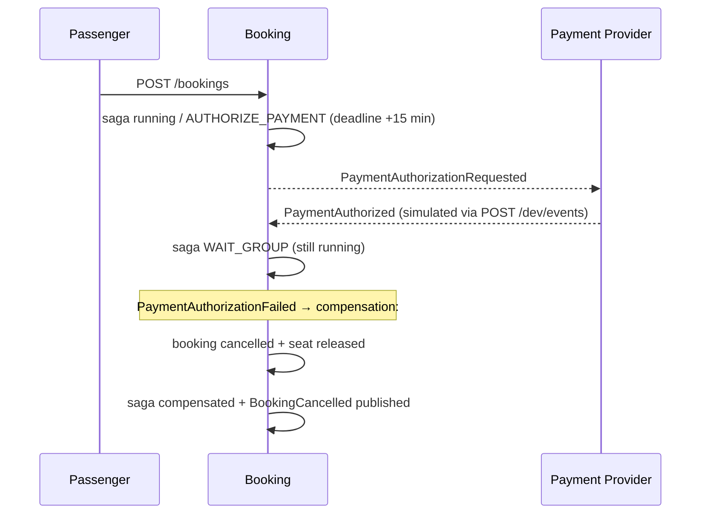
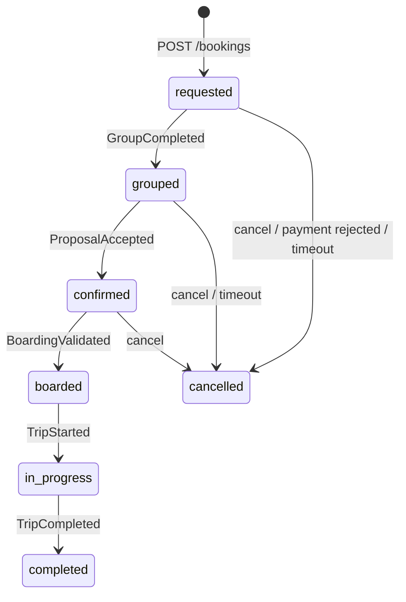

# ShareWay Booking & Pricing

Backend microservice for booking shared trips, reserving seats with optimistic locking, managing pricing rules, and estimating fares. `booking` and `pricing` are independent bounded contexts and communicate only through identifiers.

## Requirements

- Java 21
- Maven Wrapper
- PostgreSQL on `localhost:5432`
- Development database `shareway_booking`

All environment-specific configuration comes from environment variables: `DB_URL`, `DB_USER`, `DB_PASSWORD` and `SERVER_PORT`. Defaults exist **only** in the `dev` profile (`application-dev.yml`), which is also the only profile that imports the optional local `.env` file: copy `.env.example` to `.env` and set `DB_PASSWORD`. `.env` is ignored by Git and must never be committed. Environment variables supplied by the process take precedence over the file.

The `prod` profile (`application-prod.yml`) has no defaults at all, so a cloud deployment must set `SPRING_PROFILES_ACTIVE=prod` together with the four variables. For IntelliJ, either configure them under **Run Configuration -> Environment variables** or keep them in the local `.env` file and launch with the `dev` profile. The platform fee is not configurable per environment, it comes from the `fare_rules.platform_fee_pct` column of the active fare rule.

```powershell
./mvnw.cmd spring-boot:run "-Dspring-boot.run.profiles=dev"
```

The application uses Flyway migrations (`V1__create_booking_tables` schema plus `V2__seed_test_data`) and `spring.jpa.hibernate.ddl-auto=validate`.

## Integration-test database

Integration tests use local PostgreSQL only, never the development database. Create the separate test database once:

```powershell
psql -h localhost -p 5432 -U postgres -d postgres `
  -c 'CREATE DATABASE "shareway-booking-pricing-test";'
```

Define `DB_PASSWORD` for the development application. Define `TEST_DB_PASSWORD` as well when the test database uses a different password. Tests accept `TEST_DB_URL` and `TEST_DB_USER`, but the safe default is `jdbc:postgresql://localhost:5432/shareway-booking-pricing-test`. The test profile configures a 30-connection Hikari pool and aborts if the URL does not point to `localhost` and a database ending in `-test`.

Run the full suite from a terminal:

```powershell
$env:DB_PASSWORD = "your-development-password"
$env:TEST_DB_PASSWORD = "your-test-password"
./mvnw.cmd -q verify
```

In IntelliJ, open the test Run Configuration, set the same environment variables (`DB_PASSWORD`, `TEST_DB_PASSWORD`, and optionally `TEST_DB_URL`/`TEST_DB_USER`), and run the tests. Do not point test variables to `shareway_booking`.

## Local database reset

`docs/db/reset-local.sql` is a manual development-only operation. Before running it, verify that the connection is exactly `jdbc:postgresql://localhost:5432/shareway_booking`. It drops and recreates only the `public` schema:

```bash
psql -h localhost -p 5432 -U postgres -d shareway_booking \
  -f docs/db/reset-local.sql
```

The same script can be run from an IntelliJ PostgreSQL console. It is never executed automatically by the application.

## API

- `POST /bookings` (body `groupId` + `requestId`; cabeceras `X-User-Id` e `Idempotency-Key`) returns `202 Accepted` with `Location` and `{bookingId, status: REQUESTED}`. In one local transaction it holds a seat of `seat_inventories` with an optimistic lock, creates the booking in `requested`, records the `estimated` fare, starts the booking saga (`running`, `current_step=AUTHORIZE_PAYMENT`, `deadline_at=now+15min`) and publishes `SeatHeld` + `PaymentAuthorizationRequested`. Replaying the same `Idempotency-Key` returns the original booking without creating another one. `400` if `groupId`, `requestId` or `X-User-Id` is missing; `404` if the group is unknown or no fare rule is valid today; `409` with `"El viaje ya no tiene asientos disponibles."` when there are no seats or the optimistic lock keeps failing after `booking.reservation.max-attempts` retries.
- `GET /bookings/{bookingId}` returns `200 {bookingId, status}` (status in uppercase) or `404`.
- `POST /bookings/{bookingId}/cancel` cancels a booking and releases its seat. Only bookings in `REQUESTED`, `GROUPED` or `CONFIRMED` can be cancelled; `boarded`, `in_progress` or `completed` answer `409` with a clear message, cancelling twice answers `200` without changes and an unknown booking answers `404`. The passenger comes from `X-User-Id`: the owner gets `200 {bookingId, status: CANCELLED, penaltyAmount, currency}` (`penaltyAmount` is `null` when there is no penalty), a missing header `400` and another passenger `404`. A cancellation closer than 30 minutes to the departure also creates a `penalties` row (20 % of the estimated fare, minimum 1.00, reason `LATE_CANCELLATION`).
- `POST /dev/events` (only with the `dev` profile) publishes a simulated event through the same in-memory bus; see [Simulated events](#simulated-events-dev-profile).
- `GET /fare-rules` lists the fare rules.
- `GET /fare-rules/{id}` retrieves one rule. The contract exposes **only GET** for fare rules: there is no `POST` and no `PUT`.
- `GET /fares/estimate?groupId=` returns `200 {amount, currency, ruleVersion}`; `404` when the group has no seat inventory or no fare rule is valid today. Read-only: nothing is persisted.
- Swagger UI: `/swagger-ui.html`
- OpenAPI document: `/v3/api-docs`
- Health: `GET /actuator/health` with liveness and readiness (`/actuator/health/liveness`, `/actuator/health/readiness`) and `GET /actuator/info`. Only `health` and `info` are exposed; no other actuator endpoint exists.

This service performs no authentication: the passenger comes from the `X-User-Id` header, which the API Gateway validates before forwarding it. `POST /bookings` answers `400` when that header is missing. No JWT scheme is exposed in the OpenAPI document.

> **Nota:** Este servicio debe quedar detrás del API Gateway; no exponerlo directamente a internet.

## Fare estimate assumptions

`GET /fares/estimate?groupId=` is priced by the `FarePolicy` strategy (`DistanceBasedFarePolicy`). Until the neighbouring services land, the endpoint runs on these assumptions:

- **Rule selection**: the active rule is the highest-`version` `fare_rules` row whose `valid_from`/`valid_to` range includes today. If none is valid, the endpoint answers `404`.
- **Formula**: `amount = farePerPassenger + platformFee`, where `farePerPassenger = (base_amount + amount_per_km * distance_km) / passengers` and `platformFee = farePerPassenger * platform_fee_pct / 100`. Every money step rounds `HALF_UP` to 2 decimals.
- **Distance comes from another service**: Driver Operations & Routing owns the route. While it has no endpoint, `GroupInfoProvider` is satisfied by `FakeGroupInfoProvider`, which quotes every group with a fixed **12 km**.
- **Passengers are local**: `groupedPassengers = seat_inventories.capacity - seat_inventories.available_seats` (seats already held), with a **minimum of 1** — an empty group is quoted as a solo rider, as required by the strategy.
- **Currency**: `PEN` (the `Money` value object default; `fare_rules` has no currency column).
- **Read-only**: the estimate never writes a `fares` row; that row belongs to the booking flow (`estimated`/`final` per booking).
- **`404` semantics**: unknown `groupId` (no `seat_inventories` row) or no valid fare rule. There is no `422`: the price of a missing configuration is "unknown", not "unprocessable".

## Booking saga



Events travel through the `EventPublisher` interface with an in-memory implementation (`InMemoryEventPublisher`): each publish dispatches synchronously to every registered `EventHandler` that supports the event type.

| Event | Handler | Effect (one local transaction each) |
|---|---|---|
| `TripGroupOpened` | `TripGroupOpenedHandler` | Creates the `seat_inventory` (`available_seats = capacity`). Re-delivery is a no-op. |
| `PaymentAuthorized` | `PaymentAuthorizedHandler` | Saga advances to `WAIT_GROUP` and stays `running` (deadline +`BOOKING_SAGA_GROUP_TIMEOUT_MINUTES`). Ignored if the saga already finished. |
| `PaymentAuthorizationFailed` | `PaymentAuthorizationFailedHandler` | Compensates: booking → `cancelled`, seat released (`available_seats + 1`), saga → `compensated`, publishes `BookingCancelled`. Re-delivery does not release a second seat. |
| `GroupCompleted` | `GroupCompletedHandler` | `requested` bookings of the group → `grouped`; running saga → `SEARCH_DRIVER` (deadline +`BOOKING_SAGA_DRIVER_TIMEOUT_MINUTES`). |
| `ProposalAccepted` | `ProposalAcceptedHandler` | `grouped` bookings → `confirmed`: generates PIN + QR token, stores only their hashes, publishes `BookingConfirmed` once with the clear codes and completes the saga. |
| `RouteUpdated` | `RouteUpdatedHandler` | Recalculates the `estimated` fare of the group's active bookings with the new distance and updates the `fares` row in place. Publishes nothing in return. |
| `BoardingValidated` | `BoardingValidatedHandler` | `confirmed` → `boarded`. |
| `TripStarted` | `TripStartedHandler` | `boarded` bookings of the group → `in_progress`. |
| `TripCompleted` | `TripCompletedHandler` | `in_progress` bookings → `completed`: prices the `final` fare with the real distance (never duplicated) and publishes `FinalFareCalculated`. |

Published by `POST /bookings`: `SeatHeld` and `PaymentAuthorizationRequested`. Published by the lifecycle (Sprint 2): `BookingConfirmed` (confirmation) and `FinalFareCalculated` (closing); `BookingCancelled` is published by the cancellation, the rejected payment and the saga timeout job.

Events live only in this JVM process and are lost if the application stops during processing; a durable Event Bus with retries and an Outbox is future work.

### Simulated events (dev profile)

To exercise the handlers by hand, start the application with the `dev` profile and call `POST /dev/events` (the controller does not exist in any other profile):

```powershell
./mvnw.cmd spring-boot:run "-Dspring-boot.run.profiles=dev"
```

```bash
# open a group (creates seat_inventories with 4 seats)
curl -X POST localhost:8080/dev/events -H "Content-Type: application/json" \
  -d '{"type":"TripGroupOpened","groupId":"11111111-1111-1111-1111-111111111111","capacity":4}'

# happy path: payment authorized -> saga WAIT_GROUP
curl -X POST localhost:8080/dev/events -H "Content-Type: application/json" \
  -d '{"type":"PaymentAuthorized","bookingId":"<booking-id>"}'

# compensation: booking cancelled, seat +1, saga compensated, BookingCancelled published
curl -X POST localhost:8080/dev/events -H "Content-Type: application/json" \
  -d '{"type":"PaymentAuthorizationFailed","bookingId":"<booking-id>","reason":"card declined"}'

# lifecycle (Sprint 2): group completed, driver accepted, boarding scanned, trip started and finished
curl -X POST localhost:8080/dev/events -H "Content-Type: application/json" \
  -d '{"type":"GroupCompleted","groupId":"<group-id>"}'
curl -X POST localhost:8080/dev/events -H "Content-Type: application/json" \
  -d '{"type":"ProposalAccepted","groupId":"<group-id>","driverId":"<driver-id>"}'
curl -X POST localhost:8080/dev/events -H "Content-Type: application/json" \
  -d '{"type":"RouteUpdated","groupId":"<group-id>","distanceKm":20}'
curl -X POST localhost:8080/dev/events -H "Content-Type: application/json" \
  -d '{"type":"BoardingValidated","bookingId":"<booking-id>"}'
curl -X POST localhost:8080/dev/events -H "Content-Type: application/json" \
  -d '{"type":"TripStarted","groupId":"<group-id>"}'
curl -X POST localhost:8080/dev/events -H "Content-Type: application/json" \
  -d '{"type":"TripCompleted","groupId":"<group-id>","distanceKm":18}'
```

Supported `type` values: `TripGroupOpened`, `PaymentAuthorized`, `PaymentAuthorizationFailed`, `GroupCompleted`, `ProposalAccepted`, `RouteUpdated`, `BoardingValidated`, `TripStarted`, `TripCompleted`. `400` for an unsupported `type` or missing required fields; `404` for an unknown `bookingId`/`groupId` (raised while handling).

## Sprint 2

Sprint 2 completes the booking lifecycle on top of the sprint-1 base: no schema change was needed (`pin_hash`, `qr_token_hash`, every status and the `penalties` table were already in `V1`).

### State flow



In the API the status is uppercase (`REQUESTED`); in the database it is lowercase. Any other transition throws `InvalidBookingTransitionException` (409).

### Consumed events (all idempotent)

A re-delivered event, or one that targets a booking already in that state or further ahead, changes nothing and raises no error.

| Event | Payload | Effect |
|---|---|---|
| `GroupCompleted` | `{groupId}` | `requested` bookings → `grouped`; running saga → `SEARCH_DRIVER` |
| `ProposalAccepted` | `{groupId, driverId}` | `grouped` bookings → `confirmed` (see Confirmation); saga → `completed` |
| `RouteUpdated` | `{groupId, distanceKm}` | Recalculates the `estimated` fare of the group's active bookings and updates the `fares` row in place |
| `BoardingValidated` | `{bookingId}` | `confirmed` → `boarded` |
| `TripStarted` | `{groupId}` | `boarded` bookings → `in_progress` |
| `TripCompleted` | `{groupId, distanceKm}` | `in_progress` → `completed` (see Closing) |

### Published events

`SeatHeld`, `PaymentAuthorizationRequested` and `BookingCancelled` (sprint 1) plus:

- `BookingConfirmed {bookingId, groupId, passengerId, driverId, boardingPin, qrToken}` — once, at confirmation, with the codes **in clear** (the notification service needs them).
- `FinalFareCalculated {bookingId, amount, currency, ruleVersion}` — once, when the trip closes.

### Confirmation

On `ProposalAccepted` each grouped booking generates a 6-digit PIN and a random QR token (`BoardingCodeGenerator`, `SecureRandom`). `bookings` stores **only their hashes**: BCrypt for `pin_hash`, SHA-256 for `qr_token_hash`. The clear values travel once inside `BookingConfirmed` and are **never** returned by the API nor written to any log.

### Closing

On `TripCompleted` the final fare is priced with the **real** distance carried by the event, the same `FarePolicy` strategy and the fare rule valid that day. It is stored in `fares` with `fare_type = final` (UNIQUE with `booking_id`: a re-delivery never duplicates it) and `FinalFareCalculated` is published with the amount, currency and rule version.

### Cancellation and penalty

`POST /bookings/{id}/cancel` (US-12):

- Allowed from `requested`, `grouped` or `confirmed`. An already cancelled booking answers `200` with no changes (idempotent, no second seat, no second penalty); `boarded`, `in_progress` or `completed` answer `409`; an unknown booking answers `404`.
- It releases the seat immediately (`available_seats + 1`, never above `capacity`), moves the booking to `cancelled`, leaves the saga `compensated` and publishes `BookingCancelled`. The seat row is locked (`SELECT ... FOR UPDATE`) so simultaneous cancellations of the same group cannot lose an update.
- Closer than 30 minutes to the departure it also creates a `penalties` row through the `CancellationPolicy` Strategy: **20 % of the estimated fare of the booking, minimum 1.00, reason `LATE_CANCELLATION`**.
- Answers `200 {bookingId, status: CANCELLED, penaltyAmount, currency}` with `penaltyAmount = null` when no penalty was created.

### Saga timeouts

A scheduled job (`SagaTimeoutJob`, every minute) compensates every saga still `running` whose `deadline_at` passed: booking → `cancelled`, seat released, saga → `compensated`, `BookingCancelled` published. The reason depends on the stalled step: `PAYMENT_TIMEOUT` at `AUTHORIZE_PAYMENT`, `NO_DRIVER_AVAILABLE` at `WAIT_GROUP` or `SEARCH_DRIVER`.

### Assumptions

- **Event data**: the handler trusts the payload of each event (`distanceKm`, `driverId`, ...); events are produced by neighbouring services that own that data.
- **Penalty**: 20 % of the fare **estimated** for the booking (not the final one), rounded `HALF_UP` to 2 decimals with a 1.00 floor; the currency is the estimate's (`PEN`).
- **Boarding codes**: only hashes are stored (BCrypt PIN, SHA-256 token); the clear values exist solely in the `BookingConfirmed` event.
- **Timeouts**: payment 15 min, group 60 min, driver search 30 min, all configurable by environment variables.
- **Departure time**: it lives in Driver Operations & Routing, so `DepartureTimeProvider` is satisfied by `SimulatedDepartureTimeProvider` (departure = now + `BOOKING_DEPARTURE_SIMULATED_OFFSET_MINUTES`, default 120).
- **`RouteUpdated` publishes nothing**: only the `estimated` fare row changes; no notification event is emitted in return.
- **Passenger count** for the closing fare is the group's held seats at that moment (minimum 1), as in the estimate.

## Tests

Run the verification suite with local PostgreSQL:

```bash
./mvnw -q verify
```

It runs the unit tests plus three PostgreSQL-backed test classes (no Testcontainers): `SharewayBookingPricingApplicationTests` (Flyway migrations + Hibernate validation against the real schema), `BookingIntegrationTest`, which starts the real HTTP server and exercises the reservation flow end to end (last seat with 20 simultaneous requests, idempotent retry, rejected payment, `X-User-Id` contract, error codes, actuator and OpenAPI contracts), and `Sprint2IntegrationTest`, which covers the whole lifecycle:

1. **Full flow**: reserve → payment → group → accepted proposal → boarding → trip start → trip end, verifying every state, the stored PIN/QR hashes, the `final` fares row and the published events.
2. **Duplicated events** change nothing and never fail.
3. **Invalid transitions** (e.g. `TripCompleted` over a `requested` booking) are ignored without damaging the data.
4. **Cancellation**: far from the departure no penalty and the seat returns; inside the 30-minute window the 20 % penalty (4.27 over the 21.34 estimate) is created; cancelling twice releases no second seat.
5. **Boarded cancellation** answers `409` with a clear message.
6. **Expired saga**: the compensation cancels the booking and releases the seat (`PAYMENT_TIMEOUT` and `NO_DRIVER_AVAILABLE`).
7. **`RouteUpdated`** recalculates the estimated amount in place.
8. **Concurrency**: 20 simultaneous cancellations of distinct bookings never leave `available_seats` above `capacity`.

The test schema is reset per class (Flyway clean + migrate, `V2` seed included) and the booking tables are truncated per test method. `DB_PASSWORD` is required (`TEST_DB_PASSWORD` too when the test database uses another password); see [Integration-test database](#integration-test-database).

Events are dispatched by the in-memory `EventPublisher` and are lost if the application stops during processing. A durable event bus with retries and an Outbox remains future work. Payment REST integration, notification delivery (the consumer of `BookingConfirmed`) and Circuit Breaker remain pending.

## Deployment

### Run locally with docker compose

`docker-compose.yml` starts two services: `postgres` (image `postgres:16`, database `shareway_booking`, named volume `postgres-data`, healthcheck with `pg_isready`) and `booking-pricing`, built from the multi-stage `Dockerfile`. The application starts only after PostgreSQL reports healthy, and Flyway applies the migrations automatically on startup.

```powershell
copy .env.example .env   # set DB_PASSWORD first
docker compose up --build
```

Every sensitive value comes from `.env` (`DB_PASSWORD` is mandatory; `DB_USER` and `SERVER_PORT` are optional). `.env` is ignored by Git and by the Docker build context, so no secret reaches the repository or the image. The container receives `DB_URL`, `DB_USER`, `DB_PASSWORD`, `SPRING_PROFILES_ACTIVE=dev` and `SERVER_PORT`, and its port is mapped to the host (`8080:8080` with the example values).

Stop the stack with `docker compose down`; add `-v` to also delete the `postgres-data` volume.

### Environment variables

No real values are stored in this repository: only `.env.example` carries placeholders, and the real `.env` is never committed.

| Variable | Required | Purpose | Example value |
|---|---|---|---|
| `SPRING_PROFILES_ACTIVE` | Yes | `dev` (local) or `prod` (cloud) | `dev` |
| `DB_URL` | Yes (no default outside `dev`) | PostgreSQL JDBC URL | `jdbc:postgresql://localhost:5432/shareway_booking` |
| `DB_USER` | Yes (no default outside `dev`) | Database user | `postgres` |
| `DB_PASSWORD` | Yes | Database password | *(no example value: set it only in your local `.env`)* |
| `SERVER_PORT` | Yes (no default outside `dev`) | HTTP port of the service | `8080` |
| `TEST_DB_URL`, `TEST_DB_USER`, `TEST_DB_PASSWORD` | Optional | Override the integration-test database | `jdbc:postgresql://localhost:5432/<name>-test` |
| `BOOKING_RESERVATION_MAX_ATTEMPTS`, `BOOKING_RESERVATION_BACKOFF_MS` | Optional | Optimistic-lock retry policy | `3`, `20` |
| `BOOKING_CANCELLATION_PENALTY_WINDOW_MINUTES`, `BOOKING_CANCELLATION_PENALTY_PERCENT`, `BOOKING_CANCELLATION_MINIMUM_PENALTY_AMOUNT` | Optional | Late-cancellation window and penalty (20 %, floor 1.00) | `30`, `20`, `1.00` |
| `BOOKING_SAGA_PAYMENT_TIMEOUT_MINUTES`, `BOOKING_SAGA_GROUP_TIMEOUT_MINUTES`, `BOOKING_SAGA_DRIVER_TIMEOUT_MINUTES` | Optional | Saga deadlines per step | `15`, `60`, `30` |
| `BOOKING_SAGA_TIMEOUT_JOB_ENABLED`, `BOOKING_SAGA_TIMEOUT_JOB_CRON` | Optional | Expired-saga compensation job (every minute by default) | `true`, `0 * * * * *` |
| `BOOKING_DEPARTURE_SIMULATED_OFFSET_MINUTES` | Optional | Simulated departure (now + offset) behind `DepartureTimeProvider` | `120` |

Only `dev` supplies defaults for the first four rows; `prod` reads every value from the environment. The platform fee is not configurable: it comes from `fare_rules.platform_fee_pct`.

### Health and Swagger URLs

- Health: `http://localhost:8080/actuator/health`
- Liveness: `http://localhost:8080/actuator/health/liveness`
- Readiness: `http://localhost:8080/actuator/health/readiness`
- Info: `http://localhost:8080/actuator/info`
- Swagger UI: `http://localhost:8080/swagger-ui.html`
- OpenAPI document: `http://localhost:8080/v3/api-docs`

Only `health` and `info` are exposed by Actuator. Replace `localhost:8080` with the host and port where the service is published.

### Publish the image

The image is built from the multi-stage `Dockerfile` (Maven + JDK 21 to produce the jar, JRE 21 + jar only to run it, non-root user) and is tagged with **the version of `pom.xml` plus the short commit hash**, published to GitHub Container Registry:

```bash
VERSION=$(mvn -q -DforceStdout help:evaluate -Dexpression=project.version | grep -v '\[INFO\]')
HASH=$(git rev-parse --short HEAD)
IMAGE="ghcr.io/<organization>/shareway-booking-pricing:${VERSION}-${HASH}"

docker build -t "$IMAGE" .
docker push "$IMAGE"          # after: docker login ghcr.io (token with write:packages)
```

GitHub Actions compiles the service, runs the test suite against its own PostgreSQL service and builds the image on **every push**; the image is published **only** when a version tag such as `v0.1.0` is pushed, which keeps `ghcr.io` free of images from unfinished work.

### Rollback

Rollback means **redeploying the image with the previous version tag**: no rebuild, no code change.

1. List the published tags (`Packages` in GitHub, or `docker images ghcr.io/<organization>/shareway-booking-pricing`) and pick the previous one, e.g. `0.0.1-SNAPSHOT-<previous-hash>`.
2. Pull and deploy that exact tag with the same environment variables:

```bash
PREVIOUS="ghcr.io/<organization>/shareway-booking-pricing:0.0.1-SNAPSHOT-<previous-hash>"
docker pull "$PREVIOUS"
docker run -d --name shareway-booking-pricing -p 8080:8080 \
  -e SPRING_PROFILES_ACTIVE=prod \
  -e DB_URL="$DB_URL" -e DB_USER="$DB_USER" -e DB_PASSWORD="$DB_PASSWORD" -e SERVER_PORT=8080 \
  "$PREVIOUS"
```

With `docker-compose.yml`, point the `image:` of `booking-pricing` at `$PREVIOUS` and run `docker compose up -d --no-build`. The `postgres-data` volume is untouched, so application data survives the rollback; Flyway migrations are forward-only, so only roll back to an image whose schema is compatible with the current database.

### Evidence

| Elemento | Evidencia |
|---|---|
| Versión evaluada | `pom.xml` version `0.0.1-SNAPSHOT`, Sprint 2 on top of commit `67a6867` (still uncommitted) |
| Entorno local | `Dockerfile` (multi-stage, non-root), `docker-compose.yml` (postgres 16 + booking-pricing, healthcheck `pg_isready`), `.dockerignore`, `.env.example`, `.gitignore` ignores `.env` |
| Ejecución | `./mvnw clean verify` → `BUILD SUCCESS`, 109 tests, 0 failures · `docker compose up --build` (requires Docker on the machine) |
| Documentación (URL de Swagger) | `http://localhost:8080/swagger-ui.html` (OpenAPI: `http://localhost:8080/v3/api-docs`) |
